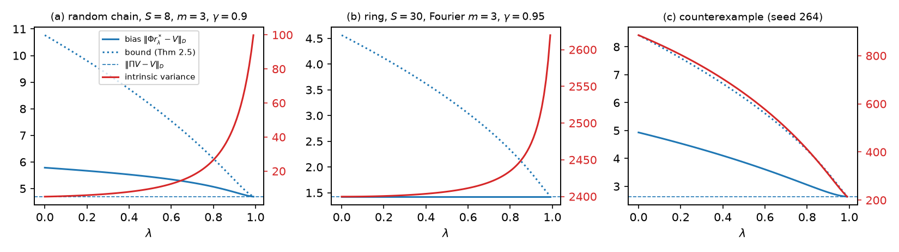
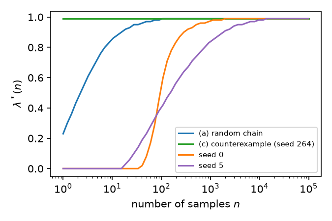

# Rates of Convergence of TD($`\lambda`$) in Finite Discounted Markov Decision Processes

*Vijaymohan Konda · November 2026*

*Generated from the LaTeX source in this directory; the PDF has the same numbering.*

> **Abstract.**
>
> For the evaluation of a fixed policy in a finite discounted MDP, we study how the trace parameter $`\lambda`$ and the choice of features affect two quantities: the quality of the TD($`\lambda`$) limit (its *bias*) and the speed at which it is reached (its *intrinsic variance*, the asymptotic mean-squared error scaled by the number of samples). Every quantity has a closed form for finite chains, including the long-run noise covariance, which we compute exactly. The results are organized as short statements with proofs; the few results we use without proof are marked as *cited facts*, and patterns supported only by computation are marked as *observations*. The main conclusions are: (i) the limit improves and the signal strengthens as $`\lambda`$ increases, with explicit constants; (ii) when the span of the features is invariant under the time-reversed chain, the limit does not depend on $`\lambda`$ at all; (iii) the intrinsic variance depends only on the span of the features, and recursive TD is never faster than least-squares TD; (iv) contrary to what the bounds suggest, the intrinsic variance is *not* monotone in $`\lambda`$ in general, and can decrease along with the bias. This chapter is the policy-evaluation layer of a study comparing actor-critic and actor-only methods.

## 1 Setting

A fixed policy in a finite MDP induces a Markov reward process; we work with that process directly.

<div id="ass:standing" class="assumption">

**Assumption 1.1** (Standing assumptions).

1.  The state space $`\mathcal{S}`$ is finite, $`P`$ is a row-stochastic matrix on $`\mathcal{S}`$, and $`g : \mathcal{S}\to \mathbb{R}`$ is the expected one-stage reward under the policy.

2.  $`P`$ is irreducible and aperiodic, with stationary distribution $`\pi`$; hence $`\pi(x) > 0`$ for all $`x`$. (For a strictly positive policy family this holds for every parameter as soon as it holds for one.)

3.  The discount factor satisfies $`\gamma \in [0,1)`$, and $`\lambda \in [0,1]`$.

4.  The feature matrix $`\Phi \in \mathbb{R}^{\mathcal{S}\times m}`$, with rows $`\phi(x)^\top`$, has linearly independent columns.

5.  Samples are on-policy: $`(x_k)`$ is the Markov chain with transition matrix $`P`$, started from $`\pi`$.

</div>

##### Notation.

$`D = \operatorname{diag}(\pi)`$, $`\langle v, w\rangle_D = v^\top D w`$, $`\|v\|_D^2 = \langle v, v\rangle_D`$. $`\Pi = \Phi(\Phi^\top D\Phi)^{-1}\Phi^\top D`$ is the $`D`$-orthogonal projection onto $`\mathop{\mathrm{span}}\Phi`$. $`V = (I - \gamma P)^{-1} g`$ is the value function. $`\tilde P(x,y) = \pi(y)P(y,x)/\pi(x)`$ is the time-reversed chain, which is the $`D`$-adjoint of $`P`$: $`\langle Pv, w\rangle_D = \langle v, \tilde Pw\rangle_D`$. We write $`c = \gamma\lambda`$ and
``` math
K_\lambda = \gamma(1-\lambda)\, P\,(I - cP)^{-1}, \qquad
  \kappa_\lambda = \frac{\gamma(1-\lambda)}{1-\gamma\lambda} \in [0,\gamma].
```
Note that $`\kappa_0 = \gamma`$, $`\kappa_1 = 0`$, and $`\kappa_\lambda`$ decreases in $`\lambda`$.

##### The algorithms.

With eligibility trace $`z_k = c\, z_{k-1} + \phi(x_k)`$ and temporal difference $`d_k(r) = g(x_k) + \gamma\phi(x_{k+1})^\top r - \phi(x_k)^\top r`$:

- *recursive TD($`\lambda`$)*: $`r_{k+1} = r_k + \alpha_k\, d_k(r_k)\, z_k`$;

- *LSTD($`\lambda`$)*: $`\hat r_n`$ solves $`\hat A_n \hat r_n + \hat b_n = 0`$, where $`\hat A_n = \frac1n\sum_{k<n} z_k(\gamma\phi(x_{k+1}) - \phi(x_k))^\top`$ and $`\hat b_n = \frac1n\sum_{k<n} z_k\, g(x_k)`$.

## 2 The limit and its quality

Both algorithms target the solution of $`A_\lambda r + b_\lambda = 0`$, where
``` math
A_\lambda = \Phi^\top D (I - cP)^{-1}(\gamma P - I)\Phi, \qquad
  b_\lambda = \Phi^\top D (I - cP)^{-1} g .
```

<div id="lem:nonexp" class="lemma">

**Lemma 2.1**. *$`\|Pv\|_D \le \|v\|_D`$ for all $`v`$.*

</div>

<div class="proof">

*Proof.* By Jensen’s inequality and stationarity, $`\|Pv\|_D^2 = \sum_x \pi(x)\big(\sum_y P(x,y)v(y)\big)^2
\le \sum_x \pi(x)\sum_y P(x,y)v(y)^2 = \sum_y \pi(y) v(y)^2`$. ◻

</div>

<div id="lem:K" class="lemma">

**Lemma 2.2**. *$`(I - cP)^{-1}(\gamma P - I) = K_\lambda - I`$, and $`\|K_\lambda v\|_D \le \kappa_\lambda\|v\|_D`$.*

</div>

<div class="proof">

*Proof.* Write $`\gamma P - I = \gamma(1-\lambda)P - (I - cP)`$ and multiply by $`(I - cP)^{-1}`$, which commutes with $`P`$. For the bound, expand $`K_\lambda = \gamma(1-\lambda)\sum_{j\ge0} c^j P^{j+1}`$ and use Lemma [2.1](#lem:nonexp): $`\|K_\lambda v\|_D \le \gamma(1-\lambda)\sum_j c^j\|v\|_D
= \kappa_\lambda\|v\|_D`$. ◻

</div>

<div id="prop:signal" class="proposition">

**Proposition 2.3** (Signal strength). For all $`r \in \mathbb{R}^m`$,
``` math
r^\top A_\lambda r \le -(1-\kappa_\lambda)\,\|\Phi r\|_D^2,
  \qquad 1 - \kappa_\lambda = \frac{1-\gamma}{1-\gamma\lambda}.
```
In particular $`A_\lambda`$ is invertible and $`r^*_\lambda = -A_\lambda^{-1}b_\lambda`$ is the unique limit. The constant $`1-\kappa_\lambda`$ increases from $`1-\gamma`$ at $`\lambda = 0`$ to $`1`$ at $`\lambda = 1`$.

</div>

<div class="proof">

*Proof.* By Lemma [2.2](#lem:K), $`r^\top A_\lambda r = \langle \Phi r, (K_\lambda - I)\Phi r\rangle_D
\le \kappa_\lambda\|\Phi r\|_D^2 - \|\Phi r\|_D^2`$ by Cauchy–Schwarz. Since $`\Phi`$ has independent columns, $`\|\Phi r\|_D > 0`$ for $`r \ne 0`$. ◻

</div>

<div id="prop:projected" class="proposition">

**Proposition 2.4** (Projected Bellman equation). *Let $`T_\lambda v = (I - cP)^{-1} g + K_\lambda v`$. Then $`V = T_\lambda V`$, and $`\Phi r^*_\lambda`$ is the unique fixed point in $`\mathop{\mathrm{span}}\Phi`$ of $`\Pi T_\lambda`$.*

</div>

<div class="proof">

*Proof.* $`(I - cP)V = g + \gamma P V - cPV = g + \gamma(1-\lambda)PV`$, so $`V = (I-cP)^{-1}g + K_\lambda V`$. For the second claim, $`A_\lambda r + b_\lambda = \Phi^\top D\big(T_\lambda \Phi r - \Phi r\big)`$ by Lemma [2.2](#lem:K), and $`\Phi^\top D w = 0`$ means $`\Pi w = 0`$. So $`A_\lambda r + b_\lambda = 0`$ if and only if $`\Pi T_\lambda\Phi r = \Phi r`$. Uniqueness: $`\Pi T_\lambda`$ is a $`\kappa_\lambda`$-contraction in $`\|\cdot\|_D`$, as $`\Pi`$ is nonexpansive. ◻

</div>

<div id="thm:bias" class="theorem">

**Theorem 2.5** (Quality of the limit).
``` math
\|\Phi r^*_\lambda - V\|_D \le \frac{\|\Pi V - V\|_D}{\sqrt{1-\kappa_\lambda^2}}.
```
At $`\lambda = 1`$ the limit is the best approximation: $`\Phi r^*_1 = \Pi V`$.

</div>

<div class="proof">

*Proof.* Since $`\Phi r^*_\lambda - \Pi V \in \mathop{\mathrm{span}}\Phi`$ is $`D`$-orthogonal to $`\Pi V - V`$,
``` math
\|\Phi r^*_\lambda - V\|_D^2 = \|\Phi r^*_\lambda - \Pi V\|_D^2 + \|\Pi V - V\|_D^2 .
```
By Proposition [2.4](#prop:projected), $`\Phi r^*_\lambda - \Pi V = \Pi T_\lambda\Phi r^*_\lambda - \Pi T_\lambda V
= \Pi K_\lambda(\Phi r^*_\lambda - V)`$, whose norm is at most $`\kappa_\lambda\|\Phi r^*_\lambda - V\|_D`$. Rearranging gives the bound; $`\kappa_1 = 0`$ gives the last claim. ◻

</div>

<div id="prop:invariant" class="proposition">

**Proposition 2.6** (Invariant subspaces remove the $`\lambda`$-dependence). *If $`\tilde P(\mathop{\mathrm{span}}\Phi) \subseteq \mathop{\mathrm{span}}\Phi`$, then $`\Phi r^*_\lambda = \Pi V`$ for every $`\lambda \in [0,1]`$.*

</div>

<div class="proof">

*Proof.* The $`D`$-adjoint of $`K_\lambda`$ is $`K_\lambda^* = \gamma(1-\lambda)\sum_j c^j\tilde P^{j+1}`$, which maps $`\mathop{\mathrm{span}}\Phi`$ into itself. Hence for $`u \in \mathop{\mathrm{span}}\Phi`$ and $`w`$ $`D`$-orthogonal to $`\mathop{\mathrm{span}}\Phi`$, $`\langle u, K_\lambda w\rangle_D = \langle K^*_\lambda u, w\rangle_D = 0`$, i.e. $`\Pi K_\lambda(I-\Pi) = 0`$. Then $`\Pi T_\lambda(\Pi V) = \Pi T_\lambda V - \Pi K_\lambda(I-\Pi)V = \Pi V`$, using $`V = T_\lambda V`$. By uniqueness (Proposition [2.4](#prop:projected)), $`\Phi r^*_\lambda = \Pi V`$. ◻

</div>

<div class="remark">

**Remark 2.7**. The hypothesis holds when $`\mathop{\mathrm{span}}\Phi`$ is spanned by eigenvectors of $`\tilde P`$, for example Fourier features on a random walk on a cycle (circulant $`P`$), which is example (b) below. Then the bias–variance trade-off in $`\lambda`$ disappears and only the variance matters.

</div>

## 3 Rates: intrinsic variance

Let $`(x_k)_{k\in\mathbb{Z}}`$ be the stationary two-sided chain, $`z_k = \sum_{i\ge0}c^i\phi(x_{k-i})`$ the stationary trace (the series converges because $`c = \gamma\lambda \le \gamma < 1`$), and
``` math
f_k = d_k(r^*_\lambda)\, z_k
```
the noise at the limit. A trace started at time $`0`$ differs from $`z_k`$ by $`c^k z_{-1}`$, which does not affect any of the asymptotic statements below.

<div id="fact:clt" class="fact">

**Cited Fact 9** (Markov chain CLT). Under Assumption [1.1](#ass:standing), $`\mathbb{E}f_k = 0`$ (Lemma [4.2](#lem:mean)), the series $`\Gamma = \sum_{l\in\mathbb{Z}}\mathbb{E}[f_0 f_l^\top]`$ converges absolutely, and $`\frac1{\sqrt n}\sum_{k<n} f_k`$ converges in distribution to $`N(0,\Gamma)`$. Moreover $`\hat A_n \to A_\lambda`$ almost surely. (Konda 2002, Thm. 6.1, whose conditions are verified for TD in Tsitsiklis and Van Roy 1997; see also Meyn and Tweedie, Ch. 17. Here $`f_k`$ is a bounded function of the past of a finite, irreducible, aperiodic chain, and its dependence on the distant past decays geometrically because the trace forgets at rate $`c`$.)

</div>

<div id="thm:lstd" class="theorem">

**Theorem 3.2** (Rate of LSTD($`\lambda`$)). $`\sqrt n(\hat r_n - r^*_\lambda)`$ converges in distribution to $`N(0,\Sigma_0)`$ with $`\Sigma_0 = A_\lambda^{-1}\Gamma A_\lambda^{-\top}`$. Consequently $`n\|\Phi(\hat r_n - r^*_\lambda)\|_D^2`$ converges in distribution to a random variable with mean equal to the *intrinsic variance*
``` math
\mathrm{IV}(\lambda) = \mathop{\mathrm{tr}}\!\big(\Sigma_0\,\Phi^\top D\Phi\big).
```

</div>

<div class="proof">

*Proof.* Since $`z_k(g(x_k) + \gamma\phi(x_{k+1})^\top r^* - \phi(x_k)^\top r^*) = f_k`$, we have $`\hat b_n + \hat A_n r^* = \frac1n\sum_{k<n} f_k`$, hence exactly
``` math
\hat r_n - r^* = -\hat A_n^{-1}\Big(\frac1n\sum_{k<n} f_k\Big).
```
Multiply by $`\sqrt n`$; by Fact [3.1](#fact:clt) and Slutsky’s lemma the limit is $`-A^{-1}N(0,\Gamma) = N(0, A^{-1}\Gamma A^{-\top})`$. By the continuous mapping theorem $`n\|\Phi(\hat r_n - r^*)\|_D^2 \to \|\Phi w\|_D^2`$ in distribution with $`w \sim N(0,\Sigma_0)`$, and $`\mathbb{E}\|\Phi w\|_D^2 = \mathop{\mathrm{tr}}(\Sigma_0\Phi^\top D\Phi)`$. ◻

</div>

<div class="remark">

**Remark 3.3**. We use the mean of the limiting distribution rather than $`\lim_n n\,\mathbb{E}\|\Phi(\hat r_n - r^*)\|_D^2`$, which can be infinite for finite $`n`$ when $`\hat A_n`$ is singular with positive probability. In simulations the two agree.

</div>

<div id="thm:basis" class="theorem">

**Theorem 3.4** (Only the span of the features matters). *Replace $`\Phi`$ by $`\Phi B`$ for an invertible $`B \in \mathbb{R}^{m\times m}`$. Then $`r^*`$, $`A`$, $`\Gamma`$, $`\Sigma_0`$ become $`B^{-1}r^*`$, $`B^\top AB`$, $`B^\top\Gamma B`$, $`B^{-1}\Sigma_0B^{-\top}`$. The LSTD approximations $`\Phi\hat r_n`$ are unchanged sample path by sample path, and so are $`\Phi r^*_\lambda`$ and $`\mathrm{IV}(\lambda)`$.*

</div>

<div class="proof">

*Proof.* Traces and features transform as $`z \mapsto B^\top z`$, $`\phi \mapsto B^\top\phi`$, so $`\hat A_n \mapsto B^\top\hat A_n B`$ and $`\hat b_n \mapsto B^\top\hat b_n`$, and the solution of the new system is $`B^{-1}\hat r_n`$; thus $`\Phi B B^{-1}\hat r_n = \Phi\hat r_n`$. The same computation applies to $`A, b, r^*`$. The noise becomes $`B^\top f_k`$, so $`\Gamma \mapsto B^\top\Gamma B`$, and $`\Sigma_0 \mapsto B^{-1}A^{-1}B^{-\top}B^\top\Gamma B B^{-1}A^{-\top}B^{-\top}`$. Finally $`\mathop{\mathrm{tr}}(B^{-1}\Sigma_0B^{-\top}B^\top\Phi^\top D\Phi B) = \mathop{\mathrm{tr}}(\Sigma_0\Phi^\top D\Phi)`$. ◻

</div>

### 3.1 Recursive TD is never faster than LSTD

<div id="fact:td" class="fact">

**Cited Fact 13** (Rate of recursive TD). With steps $`\alpha_k = \alpha/k`$ and $`K = \alpha A_\lambda + \tfrac12 I`$ Hurwitz, $`\sqrt k(r_k - r^*)`$ is asymptotically $`N(0,\Sigma_{\mathrm{TD}})`$, where $`K\Sigma_{\mathrm{TD}} + \Sigma_{\mathrm{TD}}K^\top + \alpha^2\Gamma = 0`$. (Konda 2002, Thm. 6.1; Benveniste, Métivier and Priouret, Thm. 13, p. 332.)

</div>

<div id="lem:lyap" class="lemma">

**Lemma 3.6** (Lyapunov equations). *If $`K`$ is Hurwitz and $`KX + XK^\top = -Q`$ with $`Q \succeq 0`$, then $`X = \int_0^\infty e^{Kt}Qe^{K^\top t}\,dt \succeq 0`$.*

</div>

<div class="proof">

*Proof.* $`\frac{d}{dt}\big(e^{Kt}Xe^{K^\top t}\big) = e^{Kt}(KX + XK^\top)e^{K^\top t}
= -e^{Kt}Qe^{K^\top t}`$. Integrate over $`[0,\infty)`$ and use $`e^{Kt}\to0`$. ◻

</div>

<div id="thm:td-lstd" class="theorem">

**Theorem 3.7** (TD versus LSTD). Under the conditions of Fact [3.5](#fact:td),
``` math
\Sigma_{\mathrm{TD}} - \Sigma_0 \succeq 0,
```
with equality if and only if $`(\alpha I + A_\lambda^{-1})\Gamma = 0`$; when $`\Gamma \succ 0`$, if and only if $`A_\lambda = -\alpha^{-1}I`$.

</div>

<div class="proof">

*Proof.* Write $`A = A_\lambda`$ and $`X = \Sigma_{\mathrm{TD}} - \Sigma_0`$. From $`\Sigma_0 = A^{-1}\Gamma A^{-\top}`$ we get $`K\Sigma_0 + \Sigma_0K^\top = \alpha(\Gamma A^{-\top} + A^{-1}\Gamma) + \Sigma_0`$. Hence
``` math
KX + XK^\top = -\alpha^2\Gamma - \alpha\Gamma A^{-\top} - \alpha A^{-1}\Gamma - A^{-1}\Gamma A^{-\top}
  = -(\alpha I + A^{-1})\,\Gamma\,(\alpha I + A^{-1})^\top ,
```
and Lemma [3.6](#lem:lyap) gives $`X \succeq 0`$. The integrand vanishes identically iff $`(\alpha I + A^{-1})\Gamma(\alpha I + A^{-1})^\top = 0`$, iff $`(\alpha I + A^{-1})\Gamma^{1/2} = 0`$. ◻

</div>

<div class="remark">

**Remark 3.8**. Equality needs $`A_\lambda`$ to be a negative multiple of the identity, hence symmetric. For $`\lambda = 1`$, $`A_1 = -\Phi^\top D\Phi`$ is symmetric, so TD(1) with $`\alpha = 1`$ and $`D`$-orthonormal features is as fast as LSTD(1). For $`\lambda < 1`$, $`A_\lambda`$ is generally not symmetric, and since a change of basis maps $`A`$ to $`B^\top AB`$, which preserves (non)symmetry, recursive TD($`\lambda`$) is then, when $`\Gamma \succ 0`$, strictly slower than LSTD($`\lambda`$) in every basis and for every $`\alpha`$. (Polyak–Ruppert averaging of the recursive iterates recovers $`\Sigma_0`$; Konda 2002, Sec. 6.2.1.)

</div>

## 4 Exact computation of the noise covariance

We now give $`\Gamma`$ in closed form. Let $`r = r^*_\lambda`$ and define
``` math
\begin{align*}
  d(x,y) &= g(x) + \gamma\phi(y)^\top r - \phi(x)^\top r, &
  \bar d(x) &= \textstyle\sum_y P(x,y)d(x,y), \\
  u &= (I - cP)^{-1}\bar d \in \mathbb{R}^\mathcal{S}, &
  W(x) &= \phi(x)\,u(x) \in \mathbb{R}^m, \\
  \mu &= (I - c\tilde P)^{-1}\Phi, &
  \mu^-(x) &= \textstyle\sum_y\tilde P(x,y)\mu(y),
\end{align*}
```
and let $`q = \sum_{n\ge1}P^nW = (Z - I)W`$ with $`Z = (I - P + \mathbf{1}\pi^\top)^{-1}`$ (convergence is shown in Lemma [4.2](#lem:mean)). Let $`M : \mathcal{S}\to \mathbb{R}^{m\times m}`$ be the solution of the linear system
``` math
M(x) = \phi(x)\phi(x)^\top + c\big(\phi(x)\mu^-(x)^\top + \mu^-(x)\phi(x)^\top\big)
    + c^2\sum_y\tilde P(x,y)M(y),
```
which is unique since $`c^2 < 1`$.

<div id="lem:trace" class="lemma">

**Lemma 4.1** (Moments of the stationary trace). *$`\mathbb{E}[z_0 \mid x_0] = \mu(x_0)`$, $`\mathbb{E}[z_{-1}\mid x_0] = \mu^-(x_0)`$ and $`\mathbb{E}[z_0z_0^\top\mid x_0] = M(x_0)`$. Moreover, given $`x_0`$, the trace $`z_0`$ is independent of $`(x_1, x_2, \dots)`$.*

</div>

<div class="proof">

*Proof.* Run backwards in time, $`(x_0, x_{-1}, x_{-2},\dots)`$ is a Markov chain with transition matrix $`\tilde P`$, so $`\mathbb{E}[\phi(x_{-i})\mid x_0] = (\tilde P^i\Phi)(x_0)`$ and $`\mathbb{E}[z_0\mid x_0] = \sum_i c^i(\tilde P^i\Phi)(x_0) = \mu(x_0)`$; then $`\mathbb{E}[z_{-1}\mid x_0] = \mathbb{E}[\mathbb{E}[z_{-1}\mid x_{-1}]\mid x_0] = (\tilde P\mu)(x_0)`$. For the second moment, $`z_0 = \phi(x_0) + c z_{-1}`$, so $`\mathbb{E}[z_0z_0^\top\mid x_0]`$ equals $`\phi\phi^\top + c(\phi\,\mu^{-\top} + \mu^-\phi^\top) + c^2\mathbb{E}[z_{-1}z_{-1}^\top\mid x_0]`$, and by the backward Markov property the last term is $`\sum_y\tilde P(x_0,y)\mathbb{E}[z_{-1}z_{-1}^\top\mid x_{-1} = y]`$. Stationarity makes the conditional second moment the same function $`M`$ at every time. The independence claim is the Markov property: $`z_0`$ is a function of the past. ◻

</div>

<div id="lem:mean" class="lemma">

**Lemma 4.2** (Mean of the noise). *$`\mathbb{E}f_0 = \Phi^\top Du = \pi^\top W`$, and this equals $`A_\lambda r + b_\lambda = 0`$. Consequently $`\|P^nW\| \to 0`$ geometrically and $`q`$ is well defined.*

</div>

<div class="proof">

*Proof.* $`\mathbb{E}f_0 = \sum_i c^i\mathbb{E}[\phi(x_{-i})\bar d(x_0)] = \sum_i c^i\Phi^\top DP^i\bar d
= \Phi^\top Du`$, using $`\mathbb{E}[\phi(x_{-i})h(x_0)] = \Phi^\top DP^ih`$. Since $`\bar d = g + (\gamma P - I)\Phi r`$, this is $`b_\lambda + A_\lambda r = 0`$. By aperiodicity and irreducibility $`P^n \to \mathbf{1}\pi^\top`$ geometrically, so $`P^nW \to \mathbf{1}\,\pi^\top W = 0`$ geometrically; then $`\sum_{n\ge0}P^nW = \sum_{n\ge0}(P - \mathbf{1}\pi^\top)^nW = ZW`$. ◻

</div>

<div id="lem:future" class="lemma">

**Lemma 4.3** (Accumulated future noise). Let $`\mathcal F_1 = \sigma(x_j : j \le 1)`$. As $`L\to\infty`$,
``` math
\sum_{l=1}^L\mathbb{E}[f_l\mid\mathcal F_1] \longrightarrow u(x_1)\,z_1 + q(x_1) - \beta
```
boundedly and almost surely, for a deterministic vector $`\beta \in \mathbb{R}^m`$.

</div>

<div class="proof">

*Proof.* For $`l\ge1`$, $`\mathbb{E}[f_l\mid\mathcal F_l] = \bar d(x_l)z_l`$, and $`z_l = c^{l-1}z_1 + \sum_{j=2}^lc^{l-j}\phi(x_j)`$. Taking $`\mathbb{E}[\cdot\mid\mathcal F_1]`$ and summing,
``` math
\sum_{l=1}^L\mathbb{E}[f_l\mid\mathcal F_1]
  = \Big(\sum_{l=1}^Lc^{l-1}(P^{l-1}\bar d)(x_1)\Big)z_1
    + \sum_{j=2}^{L}\big(P^{j-1}[\Phi\odot u_{L-j}]\big)(x_1),
```
where $`u_N = \sum_{i=0}^Nc^iP^i\bar d`$ and $`(\Phi\odot v)(x) = \phi(x)v(x)`$. The first term tends to $`u(x_1)z_1`$. Write $`u_N = u - t_N`$ with $`\|t_N\|_\infty \le Cc^N`$. The part with $`u`$ tends to $`q(x_1)`$ by Lemma [4.2](#lem:mean). For the tail part, write $`P^{j-1} = \mathbf{1}\pi^\top + (P^{j-1} - \mathbf{1}\pi^\top)`$ with $`\|P^{j-1} - \mathbf{1}\pi^\top\|_\infty\le C\rho^{j-1}`$ for some $`\rho<1`$, and set $`N = L - j`$:
``` math
\sum_{j=2}^L P^{j-1}[\Phi\odot t_{L-j}]
  = \mathbf{1}\sum_{N=0}^{L-2}\pi^\top[\Phi\odot t_N] + O\Big(\sum_{N=0}^{L-2}\rho^{L-N-1}c^N\Big).
```
The first sum converges absolutely to some $`\beta`$, and the error term tends to zero. All quantities are bounded uniformly in $`L`$ because $`\Phi`$, $`\bar d`$ and $`z`$ are bounded. ◻

</div>

<div id="thm:gamma" class="theorem">

**Theorem 4.4** (Closed form for $`\Gamma`$). $`\Gamma = E_0 + T + T^\top`$, where
``` math
\begin{align*}
  E_0 &= \sum_{x,y}\pi(x)P(x,y)\,d(x,y)^2\,M(x), \\
  T &= \sum_{x,y}\pi(x)P(x,y)\,d(x,y)\Big[u(y)\big(c\,M(x) + \mu(x)\phi(y)^\top\big) + \mu(x)\,q(y)^\top\Big].
\end{align*}
```

</div>

<div class="proof">

*Proof.* $`E_0 = \mathbb{E}[f_0f_0^\top] = \mathbb{E}[d(x_0,x_1)^2\,\mathbb{E}[z_0z_0^\top\mid x_0,x_1]]`$, and by Lemma [4.1](#lem:trace) the inner expectation is $`M(x_0)`$. For the off-diagonal part, $`f_0`$ is $`\mathcal F_1`$-measurable, so by Lemma [4.3](#lem:future) and bounded convergence,
``` math
T = \sum_{l\ge1}\mathbb{E}[f_0f_l^\top] = \lim_L\mathbb{E}\Big[f_0\Big(\sum_{l=1}^L\mathbb{E}[f_l\mid\mathcal F_1]\Big)^\top\Big]
  = \mathbb{E}\big[f_0\big(u(x_1)z_1 + q(x_1)\big)^\top\big] - \mathbb{E}[f_0]\beta^\top ,
```
and the last term vanishes by Lemma [4.2](#lem:mean). Substitute $`z_1 = cz_0 + \phi(x_1)`$ and use Lemma [4.1](#lem:trace): $`\mathbb{E}[z_0z_1^\top\mid x_0,x_1] = cM(x_0) + \mu(x_0)\phi(x_1)^\top`$ and $`\mathbb{E}[z_0\mid x_0,x_1] = \mu(x_0)`$. Finally, $`\sum_{l\le -1}\mathbb{E}[f_0f_l^\top] = T^\top`$ by stationarity. ◻

</div>

<div class="remark">

**Remark 4.5** (Numerical check). Theorem [4.4](#thm:gamma) is implemented in `experiments/td_lambda.py`. On the two test chains below, Monte Carlo estimates of $`n\,\mathbb{E}\|\Phi(\hat r_n - r^*)\|_D^2`$ (4000 runs of length 4000) agree with $`\mathrm{IV}(\lambda)`$ to within 2%, the Monte Carlo error, for $`\lambda \in \{0, 0.5, 0.9\}`$; and $`\mathrm{IV}`$ is unchanged to six digits under random changes of basis, as Theorem [3.4](#thm:basis) predicts.

</div>

## 5 The trade-off in $`\lambda`$

<div class="definition">

**Definition 5.1**. The *asymptotic error proxy* after $`n`$ samples is $`\mathcal E_n(\lambda) = \|\Phi r^*_\lambda - V\|_D^2 + \mathrm{IV}(\lambda)/n`$, the leading terms of $`\mathbb{E}\|\Phi\hat r_n - V\|_D^2`$; and $`\lambda^*(n)`$ denotes a minimizer.

</div>

The bounds of Section 2 and Konda (2002, Sec. 6.2.2) suggest the classical picture: the bias decreases in $`\lambda`$ while the variance increases, so $`\lambda^*(n)`$ increases from small values towards $`1`$ as $`n`$ grows. The computations show that the bias half of this picture is robust, but the variance half is not.

<a id="fig:bv"></a>



**Figure 1.** Bias (blue, left axis), the bound of Theorem [2.5](#thm:bias) (dotted), the best possible error $`\|\Pi V - V\|_D`$ (dashed), and intrinsic variance (red, right axis) as functions of $`\lambda`$. (a) a random chain; (b) a slowly mixing ring with Fourier features, where Proposition [2.6](#prop:invariant) applies and the bias is flat; (c) a chain where the intrinsic variance *decreases* with $`\lambda`$.

<div id="obs:typical" class="observation">

**Observation 5.2** (Typical behaviour). For the random chain of Figure [1](#fig:bv)(a) ($`|\mathcal{S}| = 8`$, $`m = 3`$, $`\gamma = 0.9`$), the intrinsic variance grows twentyfold, from $`5.0`$ at $`\lambda = 0`$ to $`99.8`$ at $`\lambda = 0.99`$, while the bias falls from $`5.78`$ to $`4.70`$ (the best possible is $`4.69`$). Recursive TD with the best constant $`\alpha`$ has about twice the intrinsic variance of LSTD at every $`\lambda`$ (e.g. $`19.4`$ versus $`9.6`$ at $`\lambda = 0.5`$).

</div>

<div id="obs:sweep" class="observation">

**Observation 5.3** (Frequency of the patterns). Over 300 random chains ($`5 \le |\mathcal{S}| \le 14`$, $`1 \le m \le 4`$, $`\gamma \in \{0.8, 0.9, 0.95\}`$, $`\lambda`$ on a grid of 34 values in $`[0,0.99]`$):

- TD $`\ge`$ LSTD held in all 300 cases, as Theorem [3.7](#thm:td-lstd) requires; the ratio of intrinsic variances at $`\lambda = 0.3`$ had median $`1.26`$ and maximum $`17.2`$.

- $`\mathrm{IV}(\lambda)`$ was monotone increasing in 269 cases and *not* monotone in 31; in one case (Figure [1](#fig:bv)(c)) it decreased by $`76\%`$ from its maximum to $`\lambda = 0.99`$, so that $`\lambda \to 1`$ is best for every $`n`$.

- The bias was monotone decreasing in 269 cases; in the other 31 the largest increase along $`\lambda`$ was at most $`1.2\%`$ of the bias at $`\lambda = 0`$ (median $`0.05\%`$).

- In 281 cases, $`\lambda^*(n)`$ lay strictly inside $`(0,1)`$ for some $`n \in \{10, 10^2, 10^3, 10^4\}`$, so the trade-off is genuine in most instances.

</div>

<a id="fig:best"></a>



**Figure 2.** The best trace parameter $`\lambda^*(n)`$ as a function of the number of samples, for four chains. It moves from small values to $`1`$ as $`n`$ grows, at a rate set by the ratio of the bias gap to the variance gap; for the chain of Figure [1](#fig:bv)(c) it equals $`1`$ throughout.

<div id="obs:features" class="observation">

**Observation 5.4** (Features). On the ring of Figure [1](#fig:bv)(b) with nested Fourier bases of size $`m = 1, 3, 5, 7, 9, 15`$ and $`\lambda = 0.5`$, the bias decreases ($`10.58, 1.42, 0.40, 0.39, 0.37, 0.19`$), but the intrinsic variance is not monotone: $`7065`$ for $`m = 1`$, then $`2407, 2618, 2838, 2947, 3033`$. Enlarging the span can thus lower both bias and variance, or trade one for the other.

</div>

## 6 Summary and next step

- *Proved.* Larger $`\lambda`$ strengthens the signal (Proposition [2.3](#prop:signal)) and improves the guaranteed quality of the limit (Theorem [2.5](#thm:bias)); with invariant feature spans, $`\lambda`$ does not affect the limit at all (Proposition [2.6](#prop:invariant)). The rate depends only on the span of the features (Theorem [3.4](#thm:basis)), recursive TD is never faster than LSTD, and for $`\lambda < 1`$ it is strictly slower in every basis (Theorem [3.7](#thm:td-lstd)). The long-run noise covariance has a closed form (Theorem [4.4](#thm:gamma)).

- *Observed.* The intrinsic variance usually increases with $`\lambda`$, but not always, and can fall together with the bias; the number of samples at which large $`\lambda`$ pays off varies widely between instances.

The next chapter uses the same machinery for the actor: the asymptotic covariance of the actor’s parameter in a two-time-scale actor-critic algorithm reduces to a single-time-scale iteration (Konda 2002, Thm. 7.8), whose noise combines the actor’s own noise with the critic’s noise $`f_k`$ studied here. That reduction lets us compare, with exact numbers, actor-critic algorithms using TD($`\lambda`$) critics for $`\lambda < 1`$ with actor-only methods, the case left open in Section 8.4 of the thesis.

# References

- V. R. Konda. *Actor-Critic Algorithms*. PhD thesis, MIT, 2002.

- A. Benveniste, M. Métivier and P. Priouret. *Adaptive Algorithms and Stochastic Approximations*. Springer, 1990.

- S. P. Meyn and R. L. Tweedie. *Markov Chains and Stochastic Stability*. Cambridge University Press, 2nd ed., 2009.

- J. N. Tsitsiklis and B. Van Roy. An analysis of temporal-difference learning with function approximation. *IEEE Trans. Automatic Control*, 42(5):674–690, 1997.
